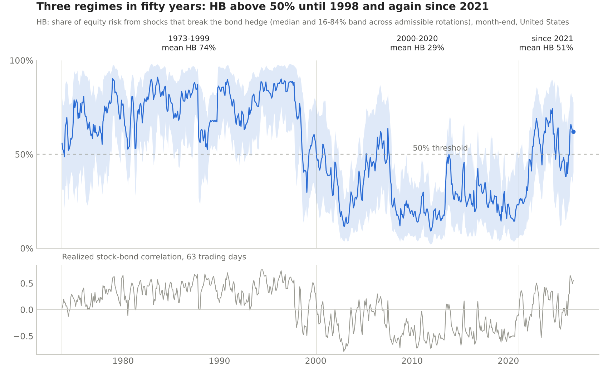

# stock-bond-hedge-regimes — When bonds stop hedging equities

*The project is called P8 in the code: Python package `p8regimes`, command-line tool `p8`.*

Real-time stock-bond regimes from sign-identified market shocks, and a regime-aware de-risking
rule evaluated against the 60/40 portfolio and a volatility target.

**Question.** In which market regimes can a multi-asset portfolio rely on government bonds to hedge
equities, and in which should it cut *both* pockets and hold cash?

**Idea.** Bonds hedge equities against some shocks and not against others. Each month, a daily VAR
on 2/5/10-year zero-coupon yields and equity returns is identified with the sign and maturity-profile
restrictions of Cieslak and Pang (2021) into four shocks:

| Shock | Equities | Yields | Bonds hedge? |
| --- | --- | --- | --- |
| growth | up | up, short end first | yes |
| hedging premium (flight to quality) | down | down, long end first | yes |
| monetary (incl. inflation via the policy rule) | down | up, short end first | **no** |
| common premium (term premium, fiscal risk) | down | up, long end first | **no** |

The indicator **HB** is the share of the last three months' equity variance that comes from the
two hedge-breaking shocks. It is estimated in real time (500-day window for the structure, 63-day
window for shock intensities, no look-ahead), with an identification band across admissible
rotations. A second signal, **P8-beta**, forecasts next quarter's bond beta from shock-specific
persistence.

**Allocation.** Hedge regime: 60/40. Cash regime: variant A scales the 60/40 down to its reference
risk, variant B drops the bond pocket and holds equities at the reference risk. Decisions at month-end,
applied the next month, 2 bp per unit of turnover (futures overlay).

**Evaluation.** One engine, only the regime signal changes: 60/40, volatility target (the real
adversary), rolling correlation, inflation rule (> 3 %), filtered HMM, P8-HB, P8-beta, oracle.
Block-bootstrap Sharpe tests, Clark-West test of whether HB forecasts next-quarter correlation beyond
the current correlation, episode readings, and the exact decomposition of P8 versus the volatility
target (proposition 4 of the note).

The full theory is in a 32-page methodological note in French, available on request.

## Results (public data, run of 19-20 November 2026)



1. **The diagnostic works in the United States.** HB tracks the three stock-bond regimes in real time:
   positive correlation until 1998, negative from 2000 to 2020, positive again since 2021.
2. **It forecasts next-quarter correlation, after 2000.** Adding HB to the lagged correlation lowers
   the out-of-sample forecast error (expanding window, Clark-West test). Nothing before 2000, when the
   correlation was persistently positive and its own past was enough.

   | Evaluation period | Forecasts | Out-of-sample R², HB | Out-of-sample R², beta forecast |
   | --- | --- | --- | --- |
   | 1978-1999 | 254 | −2.0% | +0.9% |
   | 2000-2007 | 96 | +9.2% (p = 0.007) | +9.5% (p = 0.001) |
   | 2008-2020 | 156 | +16.5% (p < 0.001) | +16.0% (p < 0.001) |
   | 2021-2026 | 66 | +4.6% (p = 0.11) | +6.4% (p = 0.07) |

3. **Switching to cash does not beat the 60/40, not even with an oracle.** Sharpe ratio 1973-2026:
   60/40 0.57, volatility target 0.55, P8-HB 0.56, oracle (knows next month's correlation) 0.56. In
   the months the rule would de-risk, the 60/40 still earned +0.41% a month: a positive stock-bond
   correlation also means both pockets rising together.
4. **Euro area (German curve, DAX): no forecasting power** (out-of-sample R² −2.6%). The likely culprit
   is that German yields and the DAX are driven by global shocks the local VAR does not separate.
5. **Robustness.** Regimes agree at 93-98% across estimation windows (W = 250-750 days, h = 42-126 days);
   deflated Sharpe ratios (Bailey and López de Prado, 2014) confirm that no strategy beats the 60/40;
   the filtered HMM benchmark is unstable across specifications (64-89% agreement).

Takeaway: the value of the decomposition is in forecasting stock-bond risk, not in timing. The next
step is to use the forecast as a continuous risk input (volatility target, bond weight) rather than a
switch.

## Quick start (any OS)

```bash
python -m venv .venv && source .venv/bin/activate     # Windows: .venv\Scripts\activate
pip install -e ".[data,dev]"
pytest -q                                             # 34 tests, about one minute
```

Then open `notebooks/02_seance_de_travail.ipynb` (French working notebook): `DEMO = True` runs on
simulated data without internet; `DEMO = False, TELECHARGER = True` downloads the public data and runs
the full study. `p8 run --demo` does the same from the command line.

## Markets and data (all public, free)

| | United States | Euro area |
| --- | --- | --- |
| Zero-coupon curve | Gürkaynak-Sack-Wright, Federal Reserve (daily, Svensson parameters) | German Federal securities, Bundesbank (fallback: ECB AAA curve) |
| Equities | CRSP value-weighted market, Kenneth French library | DAX performance index (yfinance, fallback Stooq) |
| Cash | 1-month T-bill, Kenneth French library | EONIA then €STR, ECB |
| Inflation | CPI-U, FRED | HICP annual rate, ECB |

The bond pocket is a 7-year constant-maturity zero-coupon bond rebuilt from the curve
(`r = n·y(n, t-1) − (n − Δ)·y(n − Δ, t)`, calendar-day Δ). Because it is a synthetic instrument, it is
checked against a traded fund: the iShares 7-10 Year Treasury Bond ETF (IEF, total return, since 2002)
in the United States (`checks.py`, section 4 of the working notebook). Rules of thumb: monthly
correlation ≥ 0.95 and a beta of IEF on the pocket between 0.8 and 1.2.

## Structure

```
src/p8regimes/
    config.py       parameters fixed before any backtest, markets, episodes
    data.py         downloads, tolerant parsers, manual-file override (data/raw/manual)
    curves.py       Svensson and grid curves, bond pocket, cash
    dataset.py      daily panel (VAR variables, returns) and monthly returns
    structural.py   VAR(1), Haar rotations, Cieslak-Pang restrictions, identified set
    indicator.py    real-time loop: HB, band, shock shares, structural beta and its forecast (cached)
    signals.py      competitors' regime signals, Gaussian HMM with filtered probabilities
    allocation.py   variants A and B, volatility target, k factor
    backtest.py     single monthly engine with drift, turnover and costs
    evaluation.py   measures, bootstrap Sharpe tests, Clark-West, episodes, success criteria
    simulate.py     synthetic data with known shocks (demo mode and Monte Carlo)
    checks.py       check of the 7-year zero-coupon pocket against a traded fund (IEF)
    report.py       figures
    pipeline.py     end-to-end session (used by the CLI)
    robustness.py   deflated Sharpe ratio, regime switches and costs, HMM and window stability
    journal.py      session log and HTML copy of the notebook
notebooks/
    01_theory_and_simulation.ipynb   propositions of the note and Monte Carlo (English)
    02_seance_de_travail.ipynb       working session notebook (French): one parameter cell, then Run All
tests/              propositions 1-4, parsers, curves, no look-ahead, Monte Carlo, HMM filter, backtest, pocket check,
                    deflated Sharpe, switches and break-even costs, HMM re-estimation log
launchers/          Windows launchers as .txt files (rename to .bat)
```

## Low-yield periods

When the short end is pinned at the lower bound (United States 2009-2015, Germany 2014-2021), the
restrictions on the 2-year yield can become impossible to satisfy. The indicator then relaxes them
step by step (column `level` of the output, 0 = full Cieslak-Pang) and flags the date; the shock
families, hence HB, remain defined by the signs of the equity and 5/10-year responses.

## Robustness and discipline

Section 9 bis of the working notebook (`robustness.py`), saved as CSV in `outputs/AAAA-MM-JJ/`:

- **Deflated Sharpe ratio** (Bailey and López de Prado, 2014). All candidate strategies (13 by default) are
  tried (benchmark and oracles excluded), so the best Sharpe ratio is inflated by selection. The DSR
  is the probability that the true Sharpe ratio exceeds the maximum expected by chance among N trials,
  accounting for sample length, skewness and kurtosis. It is reported for the excess return over
  cash and, more demanding, for the active return against the 60/40 and against the volatility
  target. N is given both as the raw count and as an effective number of independent trials
  (N_eff = ρ̄ + (1 − ρ̄)N, ρ̄ the average correlation between candidates). Reading: DSR > 0.95.
  Active returns are zero in hedge months, hence high kurtosis; the DSR penalises it, as it should.
- **Regime switches and costs.** Flips per year, average regime length, whipsaws (back to the
  previous regime within two months), share of turnover caused by the flips, Sharpe ratio for costs
  from 0 to 50 bp per unit of turnover, and the break-even cost against the 60/40 and the volatility
  target.
- **Stability of the filtered HMM.** Seven configurations (2 or 3 states, expanding or rolling
  10/15-year window, three single initialisations): agreement with the base run, time in cash,
  flips, Sharpe ratio, and, at each yearly re-estimation, the agreement between old and new
  parameters on the same past data and whether the current regime changes.
- **Stability of P8** (optional, `ROBUSTESSE_P8 = True`): HB and regimes for five pairs of windows
  (W, h) around (500, 63), 300 rotations per date, each run cached.

## Démarrage rapide (Windows, VS Code)

1. Dézipper le dossier, renommer `launchers/installer_windows.txt` en `installer.bat`, double-cliquer.
   L'environnement `.venv` est créé, le package installé, les tests lancés (tous doivent passer).
2. Ouvrir le dossier dans VS Code, puis `notebooks/02_seance_de_travail.ipynb`, noyau `.venv`.
3. Premier essai sans internet : `DEMO = True`, puis `Exécuter tout` (moins d'une minute).
4. Données réelles : `DEMO = False`, `TELECHARGER = True`, `MARCHE = "US"`, puis `Exécuter tout`.
   La première exécution calcule l'indicateur sur toutes les fins de mois (quelques minutes) ;
   les suivantes ne calculent que le nouveau mois. Recommencer avec `MARCHE = "EA"`.
5. Après chaque séance : `Ctrl+S`, puis relancer uniquement la dernière cellule pour la copie HTML (pendant
   « Exécuter tout », elle refuse la copie tant que le notebook n'est pas enregistré). Les traces sont dans
   `journal/journal.md` et `outputs/AAAA-MM-JJ/`.

Ligne de commande (facultatif) : `p8 fetch --market all`, `p8 status`, `p8 run --market US`,
`p8 run --demo`.

## Version 1.2 (19 November 2026)

- **Criterion 3 by sub-period** (`evaluation.forecast_by_period`, section 10 of the working notebook,
  `*_prevision_par_periode.csv`, one line in the journal). Same out-of-sample forecasts, evaluated on
  sub-periods: in the United States, 1978-1999, 2000-end, 2000-2020 and 2021-end; in the euro area,
  2004-2020 and 2021-end. A robustness check, not a pre-registered criterion.
- **Euro area data.** EONIA is tried under two ECB keys (`EON/D.EONIA_TO.RATE`, then the former
  `FM/...EONIA.HSTA`). The HICP comes from the former `ICP` dataset up to December 2025, then from the
  `HICP` dataset that replaced it on 4 February 2026 (`HICP/M.U2.N.000000.4D0.ANR`: ECOICOP 2,
  2025 = 100, Bulgaria included). The source column of the status table shows which keys were used.
- **Provisional month.** When the data end before the last business day of the month, the regime of the
  month is labelled provisional (notebook section 6 and journal).
- **Guard on the HTML copy.** The copy is refused when the notebook on disk was not saved after the
  session or shows another market.

## Status

Version 1.2.1. Personal research project on public data only, not affiliated with any employer; not
investment advice. Released under the MIT licence. The code, tests and demo run end to end. Results on real data are produced by the first
working session on a machine with internet access.

## References

Cieslak, A. and Pang, H. (2021), Common shocks in stocks and bonds, *Journal of Financial Economics*.
Brixton, A. et al. (2023), A changing stock-bond correlation, *Journal of Portfolio Management*.
Campbell, J. Y., Pflueger, C. and Viceira, L. (2020), Macroeconomic drivers of bond and equity risks, *JPE*.
Rubio-Ramírez, J., Waggoner, D. and Zha, T. (2010), *Review of Economic Studies*.
Fry, R. and Pagan, A. (2011), *Journal of Economic Literature*. Moreira, A. and Muir, T. (2017), *Journal of Finance*.
Clark, T. and West, K. (2007), *Journal of Econometrics*.
Bailey, D. and López de Prado, M. (2014), The deflated Sharpe ratio, *Journal of Portfolio Management*.
Gürkaynak, R., Sack, B. and Wright, J. (2007), *JME*.
